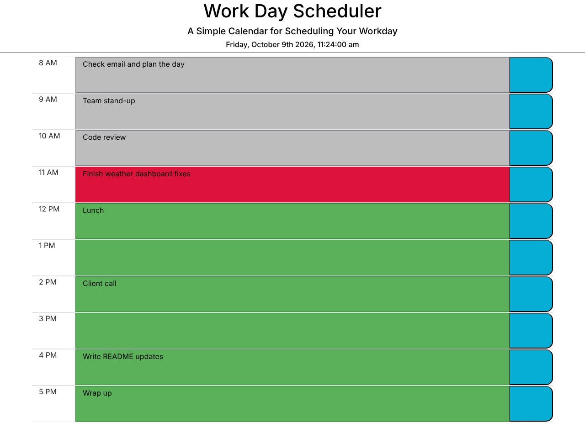

<h1 align="center">🗓️ Work Day Scheduler</h1>

<p align="center">An hour-by-hour planner for the 8 AM – 5 PM workday, color-coded by past, present and future.</p>

<p align="center">
  
  
  
  
  
</p>

<p align="center"><a href="https://christiankrantz11.github.io/Scheduler/"><strong>🚀 Live Demo</strong></a></p>

<p align="center"></p>

## Features

- Today's date and time shown at the top of the page
- Hourly time blocks from 8 AM to 5 PM
- Color-coded blocks:
  - Past hours
  - The current hour
  - Future hours
- Click a block to type an event, then press its save button
- Events are saved in the browser's `localStorage` and persist after a refresh

## Built With

- HTML, CSS, JavaScript
- [jQuery](https://jquery.com/)
- [Moment.js](https://momentjs.com/)

## Running Locally

No build step is needed.

1. Clone the repo:
   ```bash
   git clone https://github.com/ChristianKrantz11/Scheduler.git
   ```
2. Open `index.html` in your browser.

## User Story

<details>
<summary>Original assignment user story</summary>

```
AS AN employee with a busy schedule
I WANT to add important events to a daily planner
SO THAT I can manage my time effectively
```

</details>

## Author

[ChristianKrantz11](https://github.com/ChristianKrantz11)
